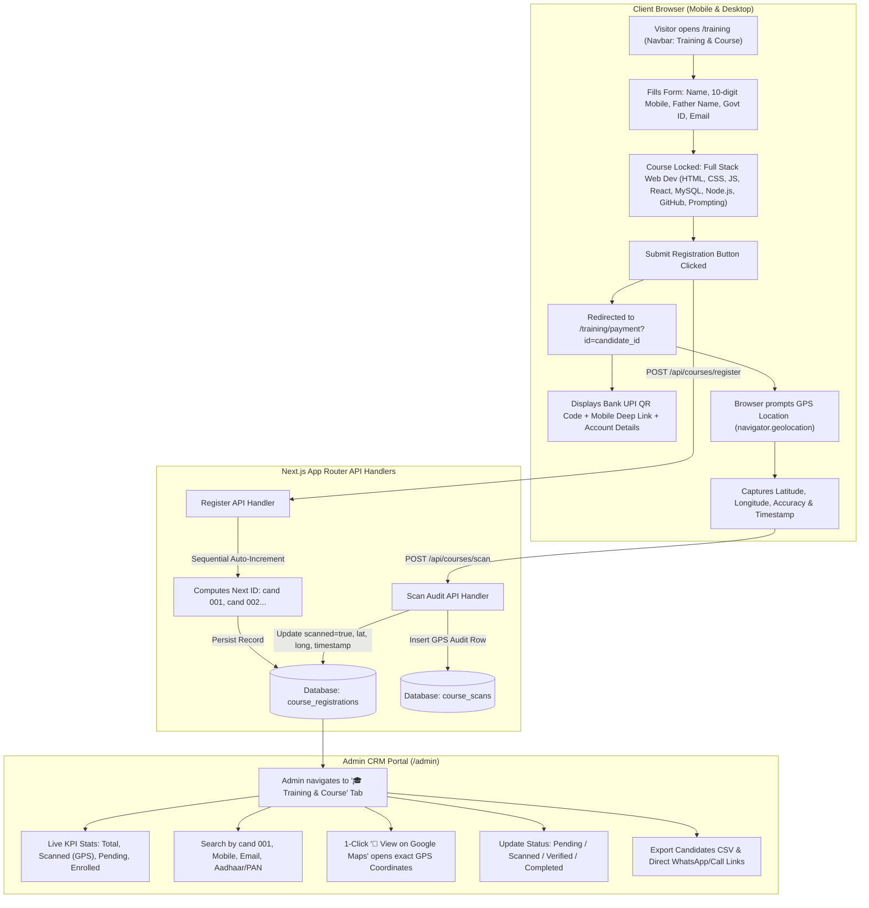

# Soft Tech Solution — Next.js Fullstack Platform

A production fullstack **Next.js (App Router)** website and client lead management platform for **Soft Tech Solution**, powered by React 19, Next.js Route Handlers, and Supabase/PostgreSQL.

---

## 🌐 Live Production Deployment (Vercel)

- **Frontend Website:** [https://soft-tech-solution-ebon.vercel.app/](https://soft-tech-solution-ebon.vercel.app/)
- **Admin Login Portal:** [https://soft-tech-solution-ebon.vercel.app/admin/login](https://soft-tech-solution-ebon.vercel.app/admin/login)
- **Admin Dashboard (Protected):** [https://soft-tech-solution-ebon.vercel.app/admin](https://soft-tech-solution-ebon.vercel.app/admin)

> **Admin Credentials for Testing:**
> - **Email:** `admin@softtechsolution.com`
> - **Password:** `admin123` *(Configure production credentials via Vercel Environment Variables)*

---

## 👥 Executive Leadership

- **Aashutosh Kumar** — *Founder*, Soft Tech Solution
  - 📞 **Mobile / WhatsApp:** `+91 9117696512`
  - ✉️ **Email:** `softtechsolution@gmail.com`
  - 🖼️ **Portrait:** [`public/ashutosh-kumar-founder.jpeg`](public/ashutosh-kumar-founder.jpeg) *(in blue coat)*

- **Ankitosh Kumar** — *Co-Founder*, Soft Tech Solution
  - 📞 **Mobile / WhatsApp:** `+91 6205570278`
  - ✉️ **Email:** `softtechsolution@gmail.com`
  - 🖼️ **Portrait:** [`public/ankitosh-kumar-cofounder.jpeg`](public/ankitosh-kumar-cofounder.jpeg) *(in blue blazer suit)*

---

## 🎯 10 Core Services (Official Poster)

1. **Web Development (`</>`)** — High-performance Next.js & React web applications.
2. **Mobile App Development (`📱`)** — iOS & Android cross-platform applications.
3. **UI/UX Design (`✒️`)** — Figma wireframing, high-converting prototypes, design systems.
4. **Cloud Solutions (`☁️`)** — Serverless architectures, Supabase databases, Vercel deployments.
5. **IT Support & More (`⚙️`)** — 24/7 technical maintenance, troubleshooting, security audits.
6. **Digital Marketing (`📢`)** — Multi-channel inbound campaigns and lead generation.
7. **SEO (`📈`)** — Search Engine Optimization, technical health, first-page Google rankings.
8. **Social Media Management (`📸`)** — Community management across Instagram, Facebook, LinkedIn, X.
9. **Google / Meta Ads (`🎯`)** — High-ROAS targeted PPC, search, and social ad campaigns.
10. **Graphics / Social Media Design (`🎨`)** — Brand kits, logo systems, marketing collateral.

**Value Pillars:**
- ✓ Creative Solutions
- ✓ Expert Team
- ✓ On-Time Delivery
- ✓ 100% Client Satisfaction

---

## 🚀 Technical Highlights

1. **Frontend (Next.js App Router):**
   - **Home (`/`):** Interactive hero with real-time metrics, dynamic glowing cards, services overview, process roadmap, case studies, client testimonials, and quick consultation inquiry form.
   - **Services (`/services`):** Complete breakdowns for all 10 services with capability tags and CTA.
   - **Our Work (`/portfolio`):** Interactive category filter (All Work, Branding, Web Design, Marketing) with case study metrics.
   - **About Us (`/about`):** Dedicated **Executive Leadership & Founders section** featuring Founder Aashutosh Kumar (left) and Co-Founder Ankitosh Kumar (right), company mission, and guiding values.
   - **Contact (`/contact`):** Full contact channels, direct lines to both founders, live inquiry submission form, and interactive FAQ accordion.
   - **Admin Login (`/admin/login`):** Dedicated secure login page for authorized administrators.
   - **Admin Portal (`/admin`):** Secure admin dashboard with KPI stats cards (Total, New, In Contact, Converted), live search filter, status dropdown update, lead deletion, and 1-click **Export to CSV**.

2. **Backend API Route Handlers:**
   - `/api/enquiries`: Handles lead submissions (`POST`), authenticated retrieval (`GET`), status/notes updates (`PATCH`), and lead deletion (`DELETE`). Includes automatic fallback storage for local development.
   - `/api/login`: Secure admin authentication (`POST`, `GET`, `DELETE`) with HMAC-signed session cookies and Bearer tokens.
   - `/api/courses/next-id`: Computes and returns the next auto-incremented candidate ID (`cand 001`, `cand 002`, etc.).
   - `/api/courses/register`: Validates candidate details (Aadhaar 12-digit / PAN format, 10-digit mobile, email) and stores enrollment records.
   - `/api/courses/scan`: Logs QR scan event with GPS coordinates (`latitude`, `longitude`, `accuracy`), timestamp, user-agent, and client IP.
   - `/api/courses`: Admin-authenticated endpoint (`GET`, `PATCH`, `DELETE`) to query, filter, update payment status, and delete registrations.
   - `/api/courses/[id]`: Fetches individual candidate profile and scan verification data.

3. **Database Integration:**
   - Supabase / Neon PostgreSQL schema with Row Level Security (`supabase_schema.sql`).
   - Tables: `enquiries`, `admin_users`, `course_registrations`, and `course_scans`.
   - Seamless local fallback storage (`.data/` directory) for resilient development when database credentials are unset.

---

## 🎓 Training & Course Platform: Flow & System Architecture

A complete industrial enrollment and payment verification engine designed for **Soft Tech Solution**, featuring automated sequential ID generation, government ID verification, dynamic bank QR generation, and real-time GPS geolocation audit tracking.

### 🏛️ End-to-End Flow & Architecture Diagram



---

### 📋 Candidate Registration Workflow (`/training`)

1. **Auto-Increment Candidate ID (`cand 001`, `cand 002`, etc.):**
   - The form contacts `/api/courses/next-id` on mount to compute the next sequential candidate ID.
   - Works across Neon Postgres, Supabase REST API, and local storage fallback.
2. **Strict Identity & Field Validations:**
   - **Candidate Full Name:** Required, minimum 2 characters.
   - **Contact Number:** Strictly validated to Indian 10-digit mobile numbers (`^[6-9]\d{9}$`) with live counter feedback (`10/10 Digits`).
   - **Father's Name:** Required, minimum 2 characters.
   - **Government ID Verification (Aadhaar / PAN):**
     - **Aadhaar Card:** Strictly validated to 12 numeric digits with automatic 4-block spacing (`XXXX XXXX XXXX`) and check against repeating identical digits.
     - **PAN Card:** Strictly validated to the standard 10-character alphanumeric structure (`[A-Z]{5}[0-9]{4}[A-Z]{1}`).
   - **Candidate Email ID:** Strict RFC email regex validation with Gmail typo prevention (`@gmai.com` warnings).
3. **Locked Single Course Selection:**
   - Pre-selected and locked to the official industrial track:
     **`Full Stack Web Development Course (HTML, CSS, JS, React, MySQL, Node.js, GitHub, Prompting etc.)`**
   - Curriculum encompasses:
     - ⚡ **HTML5 & CSS3:** Semantic markup, responsive layouts, Flexbox, CSS Grid.
     - ⚡ **JavaScript (ES6+):** Modern asynchronous programming, DOM APIs, event loop.
     - ⚡ **React.js:** Component patterns, Custom Hooks, state management.
     - ⚡ **MySQL:** Relational database design, SQL querying, indexing, and joins.
     - ⚡ **Node.js & Express:** RESTful APIs, JWT authentication, server architectures.
     - ⚡ **GitHub & Git:** Version control, branching strategies, Pull Request reviews.
     - ⚡ **AI Prompting & Engineering:** Developer toolchains with Cursor, Gemini, and ChatGPT.

---

### 💳 Bank Account QR Code & GPS Geolocation Audit (`/training/payment`)

1. **Authentic SBI Bank QR Code & Instant UPI Payments:**
   - On submission, the candidate is automatically redirected to `/training/payment?id=candidate_id`.
   - Displays the official **State Bank of India (SBI - 2414)** PhonePe QR Code (`/ashutosh-sbi-qr.png`) along with dynamic vector fallback:
     ```text
     upi://pay?pa=9142491242@ibl&pn=Aashutosh%20Kumar&tn=Course%20Enrollment%20cand%20001&cu=INR
     ```
   - **Verified Bank Transfer Details Card:**
     - **Account Holder:** `Aashutosh Kumar`
     - **Bank Name:** `State Bank of India (SBI)`
     - **Account Number:** `39797312414` (with 1-click Copy)
     - **IFSC Code:** `SBIN0003002` (with 1-click Copy)
     - **UPI ID:** `9142491242@ibl` (with 1-click Copy)
   - **Action Triggers:** 1-click **"📱 Open in UPI App Directly"** launches PhonePe, Google Pay, or Paytm; **"⬇️ Download QR"** saves the official QR code to the device.
2. **Automated Geolocation Audit Tracking:**
   - Upon viewing/scanning the QR code, the application prompts browser GPS geolocation (`navigator.geolocation.getCurrentPosition`).
   - Captures:
     - `latitude` (e.g. `25.594095`)
     - `longitude` (e.g. `85.137566`)
     - `accuracy` (in meters)
     - `scanned_at` timestamp (ISO format)
     - `ip_address` & `user_agent` (from HTTP headers)
   - Dispatches payload to `/api/courses/scan` and updates the database record.
   - Renders a live verification badge on screen:
     `✅ QR Scan Entry Recorded! Lat: 25.5941, Long: 85.1376` with a direct **"View on Google Maps ↗"** button.

---

### 🛡️ Admin CRM Dashboard (`/admin`)

Within the `/admin` portal, administrators can switch to the **"🎓 Training & Course"** tab:

| Feature | Description |
| :--- | :--- |
| **KPI Metrics** | Total Candidates, QR Scanned (with GPS), Pending QR Scan, and Enrolled & Verified counters. |
| **Search Engine** | Real-time search by Candidate ID (e.g. `cand 001`), Student Name, Mobile, Email, or Govt ID. |
| **Status Filter** | Filter by `All`, `Scanned Only (with GPS)`, `Not Scanned Yet`, `Pending`, `Verified`, `Completed`, `Cancelled`. |
| **Candidate ID Chip** | Instant 1-click copy button for `cand 001`. |
| **Direct Contact** | 1-click 📞 **Call** and 💬 **WhatsApp** direct links with pre-filled student context. |
| **GPS Verification** | Displays scanned latitude & longitude with a 1-click **"📍 View on Google Maps"** link opening `https://www.google.com/maps?q={lat},{long}`. |
| **Status Management** | Live dropdown to change status (`Pending` → `Scanned` → `Verified` → `Completed`). |
| **Candidate Modal** | Deep audit view with registration timestamp, full ID proof, GPS log, and internal **Admin Notes** editor. |
| **CSV Export** | 1-click **Export Candidates CSV** generates compliant administrative spreadsheets. |

---

### 🗄️ Database Tables Reference (`supabase_schema.sql`)

```sql
-- 1. Course Registrations Table
CREATE TABLE IF NOT EXISTS public.course_registrations (
  id TEXT PRIMARY KEY,
  candidate_id TEXT UNIQUE NOT NULL,                       -- Auto-incrementing: cand 001, cand 002...
  name TEXT NOT NULL,                                       -- Candidate full name
  contact_number TEXT NOT NULL,                             -- Exactly 10 digits
  father_name TEXT NOT NULL,                                -- Father's name
  id_type TEXT NOT NULL CHECK (id_type IN ('AADHAAR', 'PAN')),
  id_number TEXT NOT NULL,                                  -- Aadhaar (12 digits) or PAN (10 chars)
  email TEXT NOT NULL,                                      -- Email address
  course TEXT NOT NULL DEFAULT 'Full Stack Web Development Course (HTML, CSS, JS, React, MySQL, Node.js, GitHub, Prompting etc.)',
  scanned BOOLEAN NOT NULL DEFAULT FALSE,                   -- QR scan status
  scanned_at TIMESTAMPTZ,                                   -- Timestamp of QR scan
  scan_lat DOUBLE PRECISION,                                -- GPS Latitude
  scan_long DOUBLE PRECISION,                               -- GPS Longitude
  scan_count INTEGER NOT NULL DEFAULT 0,                    -- Total scan count
  payment_status TEXT NOT NULL DEFAULT 'Pending' 
    CHECK (payment_status IN ('Pending', 'Scanned', 'Verified', 'Completed', 'Cancelled')),
  notes TEXT DEFAULT '',                                    -- Internal admin notes
  created_at TIMESTAMPTZ NOT NULL DEFAULT NOW()
);

-- 2. Course Scans Audit Log Table
CREATE TABLE IF NOT EXISTS public.course_scans (
  id TEXT PRIMARY KEY,
  candidate_id TEXT NOT NULL,
  scanned_at TIMESTAMPTZ NOT NULL DEFAULT NOW(),
  latitude DOUBLE PRECISION,
  longitude DOUBLE PRECISION,
  accuracy DOUBLE PRECISION,
  user_agent TEXT,
  ip_address TEXT
);
```

---

## 💻 How to Run Locally

### Prerequisites
- Node.js (version 18.0.0 or higher)
- npm (version 9.0.0 or higher)

### Steps

1. **Open terminal inside the project directory:**
   ```bash
   cd "d:/E DRIVE/Project/MCA/Startup/soft-tech"
   ```

2. **Install dependencies:**
   ```bash
   npm install
   ```

3. **Start the development server:**
   ```bash
   npm run dev
   ```

4. **Open in browser:**
   - Website: [http://localhost:3000](http://localhost:3000)
   - About Us & Founders: [http://localhost:3000/about](http://localhost:3000/about)
   - Contact Page: [http://localhost:3000/contact](http://localhost:3000/contact)
   - Admin Login: [http://localhost:3000/admin/login](http://localhost:3000/admin/login)
   - Admin Portal: [http://localhost:3000/admin](http://localhost:3000/admin)

5. **Production Build & Verification:**
   ```bash
   npm run build
   npm run start
   ```

---

## ☁️ How to Deploy Live to Vercel

### Method 1: Deploy via GitHub (Active)
1. Push your repository to GitHub:
   ```bash
   git add .
   git commit -m "update: documentation and live links"
   git push origin main
   ```
2. Connected GitHub Repository: **[https://github.com/AnkitoshK/soft-tech-solution](https://github.com/AnkitoshK/soft-tech-solution)**
3. In your Vercel Dashboard for `soft-tech-solution-ebon`:
   - Vercel automatically redeploys on every `git push`.
   - In **Settings > Environment Variables**, add:
     * `ADMIN_EMAIL` — `admin@softtechsolution.com`
     * `ADMIN_PASSWORD` — your strong admin password
     * `ADMIN_SESSION_SECRET` — a random 32+ character string
     * `POSTGRES_URL` or `DATABASE_URL` — (recommended) Neon / Vercel Postgres connection string
     * `SUPABASE_URL` — (optional) Supabase project URL
     * `SUPABASE_SERVICE_ROLE_KEY` — (optional) Supabase service role key

---

## 🗄️ Database Setup (Neon / Vercel Postgres — Recommended)

To ensure client proposals and inquiries are permanently stored and visible in the Admin Panel on Vercel:

1. Open your project on the [Vercel Dashboard](https://vercel.com/dashboard).
2. Click the **Storage** tab.
3. Click **Create Database** and select **Postgres (Powered by Neon)**.
4. Click **Continue** and connect it to your project (`soft-tech-solution-ebon`).
5. **Done!** Vercel automatically configures `POSTGRES_URL`. The table and indexes self-initialize on the first submission.

### Alternative: Supabase
1. Create a free project at [supabase.com](https://supabase.com).
2. Go to **SQL Editor** and run `supabase_schema.sql`.
3. Add `SUPABASE_URL` and `SUPABASE_SERVICE_ROLE_KEY` in Vercel **Settings > Environment Variables**.

---

## 📁 Project Structure

```text
soft-tech/
├── app/
│   ├── about/page.jsx         # About Us & Executive Leadership (Founders)
│   ├── admin/
│   │   ├── login/page.jsx     # Dedicated Admin Login page
│   │   └── page.jsx           # Secure Admin Dashboard & CRM
│   ├── api/
│   │   ├── enquiries/route.js # Leads API (GET, POST, PATCH, DELETE)
│   │   └── login/route.js     # Admin Auth API (GET, POST, DELETE)
│   ├── contact/page.jsx       # Contact Us page + FAQs + Direct Call
│   ├── portfolio/page.jsx     # Our Work & Portfolio filter
│   ├── services/page.jsx      # 10 Services breakdown
│   ├── globals.css            # Modern design system & styles
│   ├── layout.jsx             # Root layout, metadata, fonts, header, footer
│   └── page.jsx               # Home landing page
├── components/
│   ├── ContactForm.jsx        # Interactive inquiry form with live state
│   ├── Footer.jsx             # Global website footer
│   ├── Navbar.jsx             # Responsive navigation with mobile drawer
│   └── ToastContext.jsx       # Global notification toasts
├── lib/
│   ├── auth.js                # JWT & session verification
│   └── db.js                  # Database client with local persistence & Supabase
├── public/                    # Logos, founder portraits, assets
│   ├── ankitosh-kumar-cofounder.jpeg  # Ankitosh Kumar (blue blazer suit)
│   ├── ashutosh-kumar-founder.jpeg    # Aashutosh Kumar (blue coat)
│   └── soft-tech-solution-logo.jpeg   # Company Logo
├── legacy-static/             # Safely archived previous static HTML files
├── .env.example               # Environment variables template
├── .env.local                 # Local development configuration
├── package.json               # Dependencies and scripts
└── vercel.json                # Vercel Next.js framework configuration
```

---

## 📞 Leadership Contacts
- **Aashutosh Kumar (Founder):** [+91 9117696512](tel:+919117696512)
- **Ankitosh Kumar (Co-Founder):** [+91 6205570278](tel:+916205570278)
- **Live Site:** [https://soft-tech-solution-ebon.vercel.app/](https://soft-tech-solution-ebon.vercel.app/)
- **Admin Portal:** [https://soft-tech-solution-ebon.vercel.app/admin/login](https://soft-tech-solution-ebon.vercel.app/admin/login)
